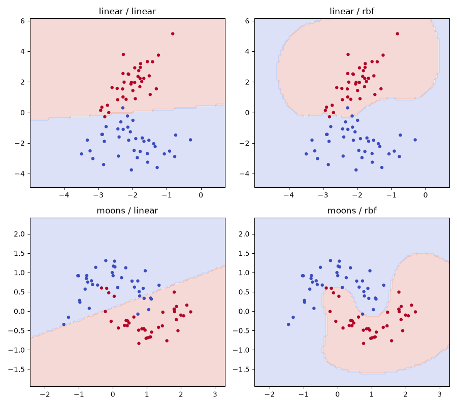

# Maximum Margin Classification

Linear and kernel SVM geometry on linear and nonlinear generated data.

**Author and maintainer:** Abhinav Tanwar.

## Run

Requires Python 3.12. Install dependencies with `python -m pip install -r requirements.txt`.

```sh
python analysis.py
python -m unittest discover -s tests
```

## Methods and limitations

Uses the original generated linear and two-moons examples. Scaling is fitted inside each training pipeline. Linear and RBF SVMs are evaluated on the same stratified test records per dataset. Hyperparameters are prespecified; boundaries are illustrations of fitted models rather than a new held-out tuning step.

## Measured results


[Full calculated metrics](results/metrics.json) · [Input provenance](data/README.md) · [Method changes](docs/methodology.md). Open `report.html` for the visual summary.

Generated examples and toy inputs are explicitly illustrative; they do not stand in for historical real-world outcomes.



The clean notebook in `notebooks/` delegates to the same module. Notebook cells were syntax-checked with outputs cleared; native scripts and tests were executed.
